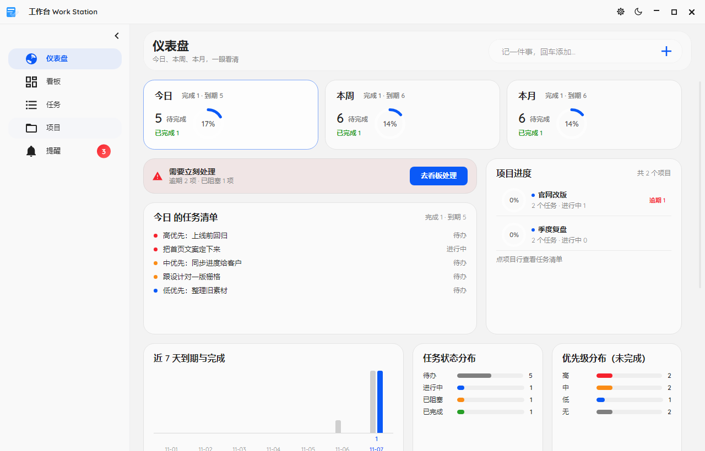
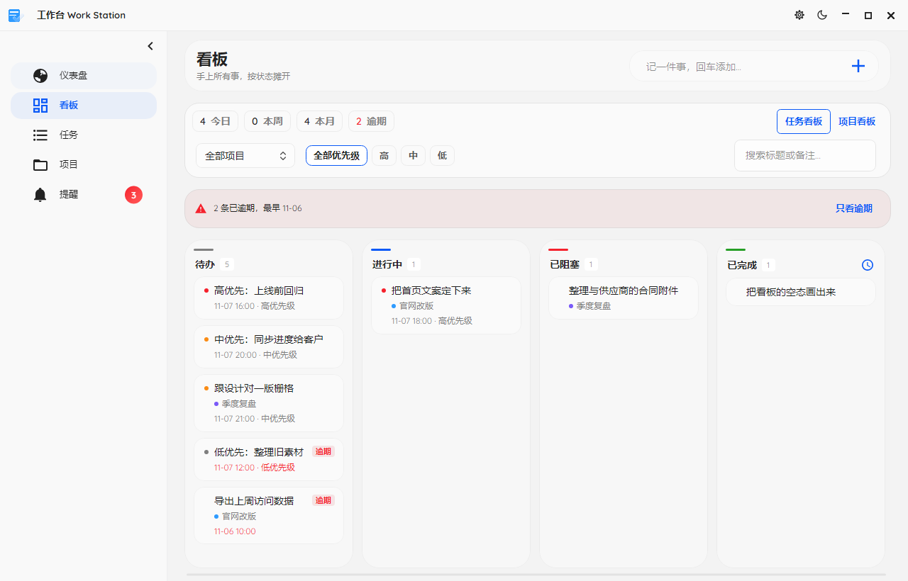
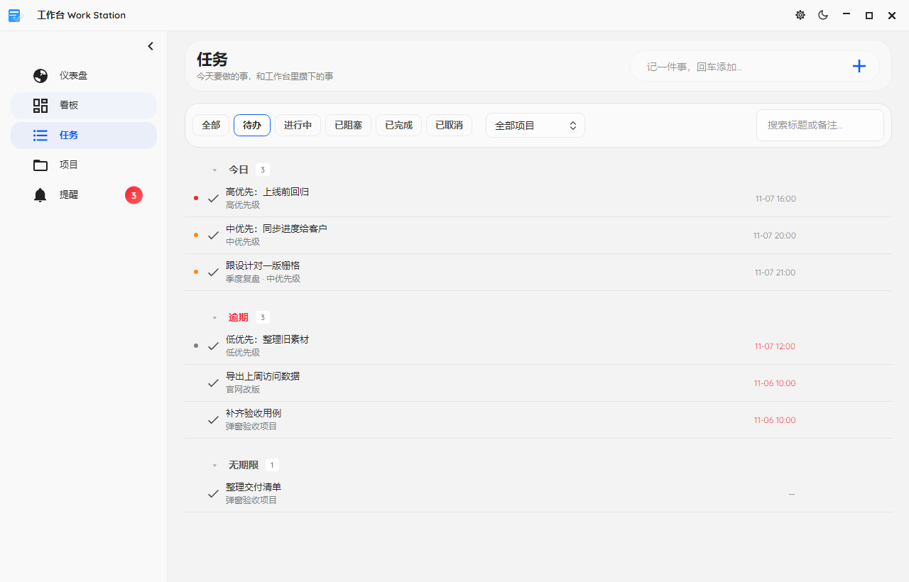
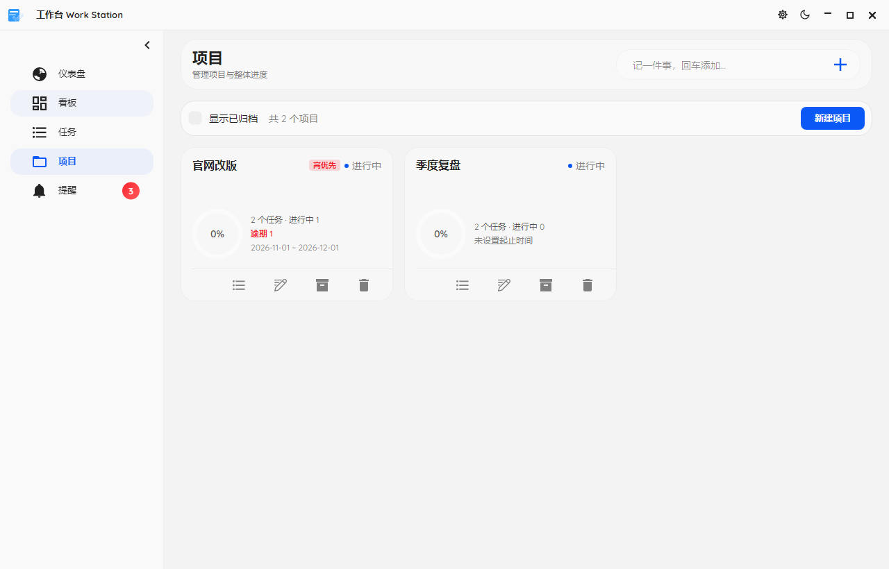
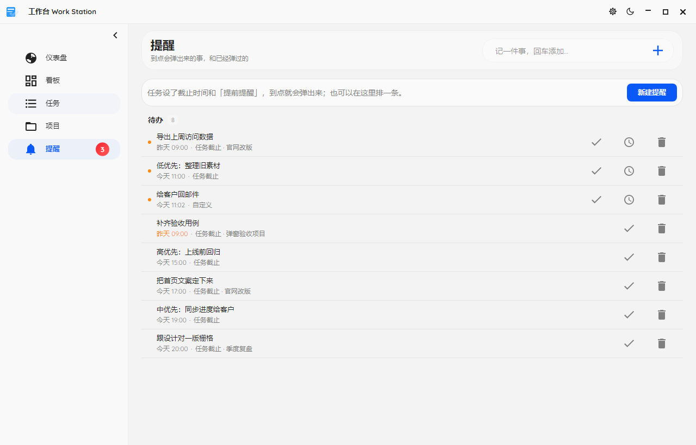
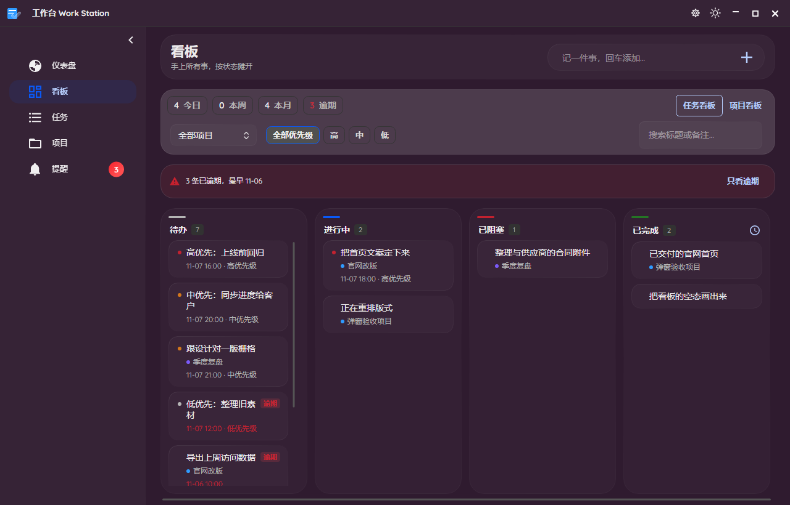
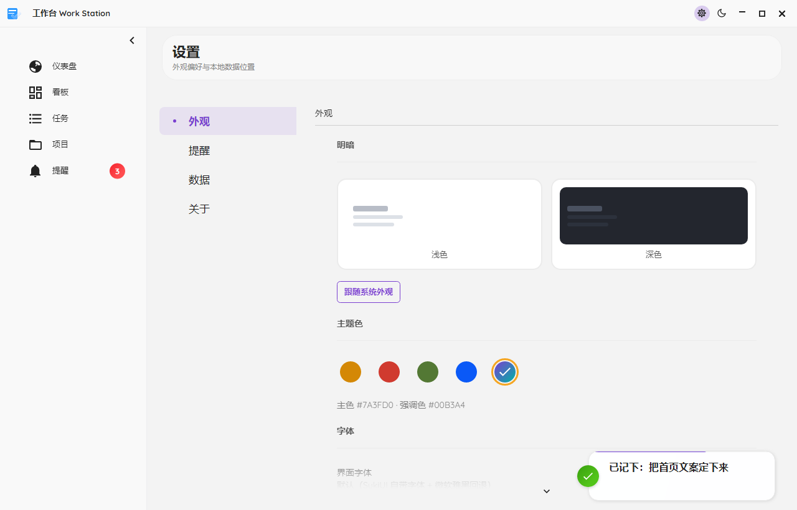
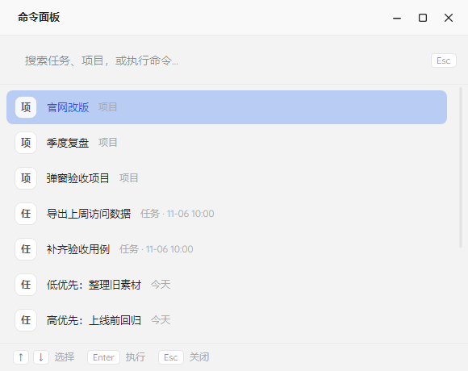
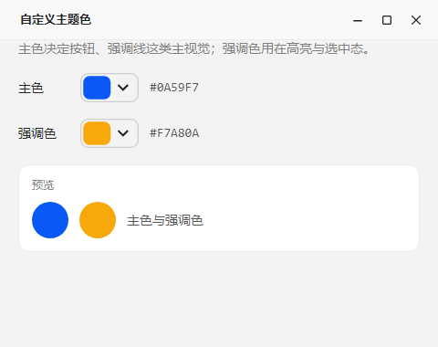

# 工作台 Work Station

个人项目管理与报告工作台：项目、任务、看板、提醒、仪表盘、命令面板。
**Avalonia 12 + SukiUI 7 + .NET 10 + SQLite**，跨平台桌面应用（Windows / macOS / Linux），
全部数据留在本机、无网络依赖、无后端服务。

> **文档约定**：本文件是稳态事实入口 —— 环境、界面预览、发布与安装、项目结构、数据存放、测试流程。
> 易变事实只在其权威文档写一份：功能与[快捷键](docs/功能说明.md#4-导航与快捷键)见
> [功能说明](docs/功能说明.md)，界面规则见[设计系统](docs/设计系统.md)，
> 开发硬约束与发版清单见 [AGENT.md](AGENT.md)。改代码时按 `AGENT.md` 的同步规则一并更新。

| 层 | 技术 |
| --- | --- |
| 界面 | Avalonia 12.1.5、SukiUI 7.0.1、CommunityToolkit.Mvvm 8.2.2、Avalonia.Headless（测试） |
| 运行时 / 数据 | .NET 10、Microsoft.Data.Sqlite + SQLitePCLRaw.bundle_e_sqlite3、xunit v3（测试） |

## 环境要求

| 场景 | 要求 |
| --- | --- |
| 开发 | .NET SDK **10.0+** |
| 运行 | **目标机什么都不用装**：发布产物自包含，运行时已打包进去（Avalonia 是普通 NuGet 包，不需要桌面运行时） |
| Windows 安装包 | Windows PowerShell 5.1 + [Inno Setup 6](https://jrsoftware.org/isdl.php) |
| Linux 安装包 | Python 3 + **Pillow**（`make-linux-packages.py` 用它缩放图标）；打包脚本本身不依赖 Linux 工具链 |

## 快速开始

```bash
dotnet run --project src/WorkStation.App
```

开发期数据库落在仓库内 `.data/data.db`，发布版落在用户应用数据目录（见[数据存放](#数据存放)）。

## 界面预览

截图来自 `Avalonia.Headless` 的真实渲染，**不是设计稿**；界面改了按[测试与截图流程](#测试与截图流程)重跑，
这里的图始终跟代码一致。默认首页是仪表盘。

| | |
| --- | --- |
|  |  |
|  |  |
|  |  |
|  |  |
|  | 明暗两套配色各自调过对比度与语义色；主色与强调色可自由取色。 |

## 功能一览

项目与看板、任务分组与筛选、仪表盘统计、三类提醒与托盘常驻、命令面板、主题与字体自定义 ——
完整清单、快捷键与已知限制见 [docs/功能说明.md](docs/功能说明.md)。

## 发布与安装

```bash
# 默认一次出 win-x64 / osx-arm64 / linux-x64；-Rid 可只出一个
powershell -ExecutionPolicy Bypass -File tools/publish.ps1 -Rid win-x64
powershell -ExecutionPolicy Bypass -File tools/build-installer.ps1        # Windows 安装包
powershell -ExecutionPolicy Bypass -File tools/linux/build-linux-packages.ps1  # Linux 安装包
```

产物都在 `dist/`（已 gitignore）。体积随依赖版本变化，以发布脚本打印的实测值为准。

**产物形态是「自包含」**：`publish.ps1` 带 `--self-contained true`，目标机不需要装 .NET。
Windows / macOS 走**单文件**（运行时压缩进一个 exe，含 Skia / HarfBuzz / SQLite 原生库）；
**Linux 走目录式** —— 单文件每次启动都要把原生库解压到 `/tmp`，桌面应用的启动延迟不能接受，
而 Debian 惯例本来就是 `/opt/app` 放文件 + `/usr/bin` 放符号链接。

> 为什么不依赖系统安装的运行时：目标机缺运行时时，apphost 会在 CLR 加载**之前**就失败
> （弹一句英文错误然后退出）——「启动时判断有没有运行时」没法写在应用代码里，
> 能跑到代码里就说明运行时已经在了。自包含把这个问题从根上消掉：装完就能用，不联网、不需要管理员。

> **不要开 `PublishTrimmed=true`**：SukiUI 的反射 Binding、`System.Text.Json` 的反射序列化会被裁掉而崩，
> 而且 partial trim 对 Avalonia 几乎不省体积。

### Windows 安装包

`tools\build-installer.ps1` 产出 `dist\installer\WorkStation-Setup-<版本>.exe`，用 Inno Setup 6 编译，
向导是中文的：

| 环节 | 行为 |
| --- | --- |
| 安装位置 | 默认 `%LOCALAPPDATA%\Programs\WorkStation`，可改 |
| 权限 | 只装给当前用户（写 HKCU），**不弹 UAC** |
| 快捷方式 | 开始菜单（含「卸载」项）+ 桌面（可选） |
| 卸载 | 「设置 → 应用」里可卸载；卸载时问一句「数据要不要一起删」，默认**保留** |
| 依赖 | 无，运行时已打包 |

定义在 `tools\installer\WorkStation.iss`；向导横幅图由 `tools\installer\make-wizard-images.py` 生成。

> 两个必须记住的坑：
> 1. Inno Setup 按 BOM 判断 `.isl` 编码，没 BOM 就按 ANSI 读，中文会整段乱码 ——
>    `build-installer.ps1` 每次编译前检查并补 BOM。
> 2. Inno Setup 6 的 `WizardImageFile` 只接受 **24 位无压缩 BMP**，PIL 默认存成 32 位带 alpha 会被拒。

### Linux 安装包

`tools\linux\build-linux-packages.ps1` 一键完成发布 → 打包 → 格式校验，产出在 `dist\linux\`：

| 包 | 给谁用 | 怎么装 |
| --- | --- | --- |
| `workstation_<版本>_amd64.deb` | Debian / Ubuntu / UOS 等 | `sudo dpkg -i workstation_<版本>_amd64.deb` |
| `workstation-<版本>-linux-x86_64.tar.gz` | Arch / Fedora / openSUSE 等 | 解压后 `bash install.sh` |

两者都自包含。`.deb` 装完是 Debian 惯例布局：`/opt/workstation/`（本体）、
`/usr/bin/workstation`（符号链接）、`/usr/share/applications/workstation.desktop`、
各尺寸图标；卸载 `sudo apt remove workstation`，**数据不删**。
绿色版不碰系统目录，装到 `~/.local` 下（不需要 root）。
`AppImage` 需要 `mksquashfs`（只有 Linux 上有），留了 `build-appimage.sh` 给绿色版用户在 Linux 上生成。

依赖写进 `.deb` 的 `Depends`：`libfontconfig1`（Skia 找字体）、`liblttng-ust1`（.NET EventPipe 硬链接）、
`libicu` 用 `|` 并列多个版本（.NET 8+ 是 dlopen 系统 ICU，各发行版 soname 带版本号）、
`libx11-6` / `libgl1` / `libegl1` 等（Avalonia 的窗口后端是运行时 dlopen，ELF 依赖表里看不到但缺了开不了窗口）。

> **`.deb` 是手写出来的** —— 不用 `dpkg-deb`，它本身就是「ar 归档 + 两个 tar.gz」，
> ar 头格式固定、tar/gzip Python 原生支持，Windows 上也能构建。格式正确性靠
> `tools\linux\verify-linux-packages.py` 的 38 项检查保证：ar 头布局、control 字段、文件权限、
> 符号链接目标、md5sums 与实际内容一致性。

## 项目结构

```text
src/
├─ WorkStation.Core/           纯逻辑层，零 UI 依赖
│  ├─ Models/                  实体、更新入参（Optional<T> 三态）、过滤条件
│  ├─ Data/                    连接、迁移、完整性检查、备份、路径解析
│  ├─ Data/Repositories/       projects / tasks / tags / settings / reminders
│  ├─ Services/                WorkStationService（UI 唯一入口，Result 契约）
│  ├─ Board/ Dashboard/ Projects/ Reminders/   看板口径、仪表盘统计、项目统计、提醒排期
│  ├─ Time/                    本地时间口径、任务默认值
│  └─ TaskOrdering.cs / TaskGrouping.cs / ProgressCalculator.cs / Formatting.cs
└─ WorkStation.App/            Avalonia 界面层
   ├─ AppServices.cs           启动装配：恢复 → 迁移 → 备份 → 服务
   ├─ ViewModels/  Views/      主窗口与各页面、命令面板、对话框
   ├─ Services/                提醒调度器（ReminderPump）与通知出口
   ├─ Platform/                托盘、单实例、启动日志
   ├─ Controls/ Converters/    AppIcons 线性图标、趋势图、值转换器
   ├─ Themes/ Assets/          取色器皮肤、应用图标
   └─ App.axaml                全局样式、版式令牌与材质
tests/WorkStation.Tests/       xUnit v3 + Avalonia.Headless（含 VisualCheck 截图回归）
tools/                         发布、Windows 安装包、Linux 安装包、截图同步脚本
docs/                          功能说明、设计系统、界面截图
```

## 数据存放

路径由 `src/WorkStation.Core/Data/AppPaths.cs` 解析，**按以下优先级**：

1. 用户自定义数据目录 —— `app-config.json` 的 `dataDirectory`（配置放在应用数据目录，不存进库里；
   「库在哪」本身就是要读的配置）。设置页可改，目录不存在时回落默认。
2. 开发期 —— 输出目录在 `bin/` 下时，用仓库根 `.data/data.db`（按 `.git` 上溯定位仓库根）。
3. 发布后 —— 应用数据目录：Windows `%APPDATA%\work-station\data.db`、
   macOS `~/Library/Application Support/work-station/`、Linux `~/.config/work-station/`。

数据库使用 WAL 模式。**退出应用后复制 `data.db` 即完成备份**；运行中复制需连同
`data.db-wal`、`data.db-shm`，更稳妥的是直接取同目录 `backups/data-<日期>.db`
（启动时已 `wal_checkpoint(TRUNCATE)`，最多保留 7 份）。

启动时若 `PRAGMA integrity_check` 失败，原库改名为 `data.db.corrupt-<日期>` 留存，
自动重建空库，界面提示留存路径。

## 测试与截图流程

```bash
dotnet test
# 只跑截图回归，输出 .shots/
dotnet test tests/WorkStation.Tests/WorkStation.Tests.csproj --filter FullyQualifiedName~VisualCheck
python tools/sync-readme-images.py     # 把 .shots/ 同步到 docs/images/
```

| 层 | 覆盖内容 |
| --- | --- |
| Core 单元 | 时间格式、进度计算、任务分组、看板口径、提醒排期、仪表盘统计、任务排序 |
| 数据层 | 迁移、完整性检查、损坏恢复、备份轮转、五个仓储的 CRUD 与聚合、任务截止时间与提醒同步 |
| 服务层 | Result 契约（不抛异常）、错误码映射、中文错误文案、提醒自动排期 |
| ViewModel | 快速添加、分组折叠、筛选搜索、抽屉与校验、看板拖拽、命令面板、主题与字体、仪表盘统计 |
| 调度器 | 单次节拍（先落状态后发通知）、重复顺延、通知失败落 `Failed`、站会一天一条 |
| UI 冒烟 | 真实 XAML 加载（Headless）、导航、快捷键、主题切换落盘、排版与字号 |
| 安装器 | 自包含配置、安装包路径、免管理员、卸载注册与数据保留、语言包与向导图片编码、`rollForward` |
| Linux 打包 | `LinuxPackageTests` 断言打包脚本源码里的关键字符串；`control` 字段、权限、md5sums 等 38 项格式校验由 `verify-linux-packages.py` 在**打包阶段**执行 |

UI 层用 `Avalonia.Headless` 承载，XAML 解析失败或编译绑定路径写错会直接让测试变红。
`VisualCheck` 的输出目录从仓库根自动定位（认 `work-station.slnx` 那一层），换机器也能跑；
`sync-readme-images.py` 按固定映射把 9 张图复制到 `docs/images/`，并检查 README 不再引用的孤儿图。
**改了界面或主题就要重跑这两步**，别让 README 的图停在旧版本。

## 文档导航

| 文档 | 内容 |
| --- | --- |
| [docs/功能说明.md](docs/功能说明.md) | 功能清单、完整快捷键、已知限制 |
| [docs/设计系统.md](docs/设计系统.md) | 现行 UI 令牌、组件规则与设计取舍 |
| [AGENT.md](AGENT.md) | 给编码代理的硬约束、发版清单、代码→文档同步规则 |
